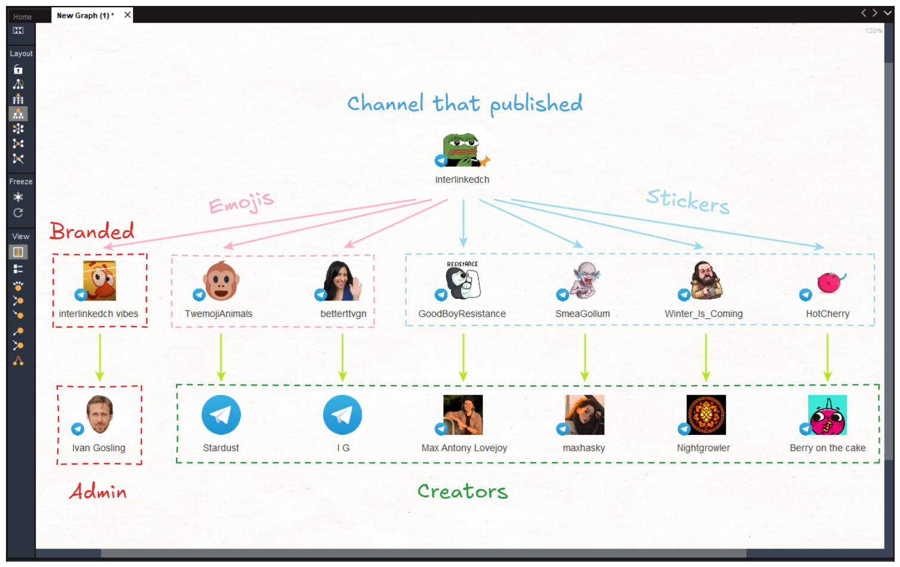

<h4 align="center">Maltego-powered OSINT tool for investigating Telegram<br></h4>

---

<p align="center">

</p>

<p align="center">
  <a href="#features">Features</a> •
  <a href="#install">Install</a> •
  <a href="#usage">Install</a> •
</p>

---

**Maltego Telegram** is an OSINT utility that enables investigations on Telegram through a collection of Maltego Transforms. It brings Telegram data into Maltego, helping investigators explore connections and visualize relationships. Maltego Telegram is built for one thing — Telegram investigations — and makes them simple and intuitive.

# Features

<h1 align="left">
  </a>
  <br>
</h1>

- Sticker pack and emojis owner identification
- User group membership mapping
- Deleted post retrieval
- Profile owner IP address disclosure through calls
- And much more

# Install

1. Clone the repository
```bash
git clone https://github.com/vognik/maltego-telegram
cd maltego-telegram
```

2. Install dependencies
```bash
pip install -r requirements.txt
```

3. Configure Telegram API credentials

Obtain your `api_id` and `api_hash` from [Telegram](https://core.telegram.org/api/obtaining_api_id), then add them to `config.ini`.


4. Log in to Telegram
```bash
python login.py
```

Follow the prompts to authenticate your Telegram account.

5. Generate Maltego Transform files
```bash
python project.py
```

6. Import into Maltego

In Maltego, open **Import Config** and import both generated files:
- `entities.mtz`
- `telegram.mtz`


# Usage

1. Drag an entity from the **Entity Palette** onto the graph.
2. Right-click the entity to view available Transforms.
3. Select a Transform to run it.

Demo

https://github.com/user-attachments/assets/dba4b5b1-a82d-4e26-b8e4-d063f5456f88

## License

Maltego Telegram is licensed under the [GNU General Public License v3.0](README.md).

Built for the OSINT community. Contributions, ideas, and feedback are welcome.

Use responsibly and only for lawful investigations.